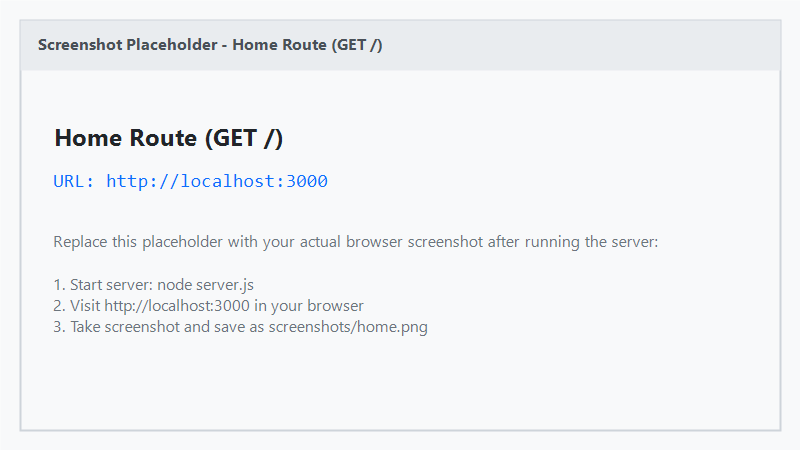
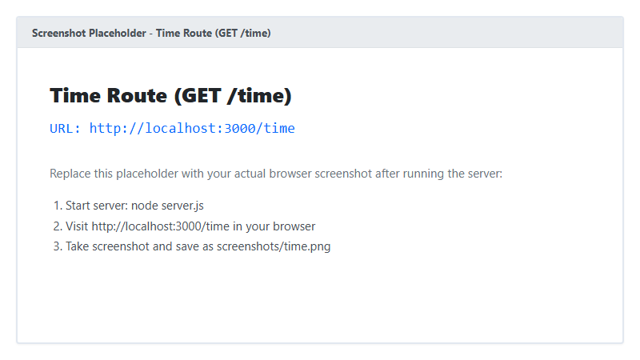
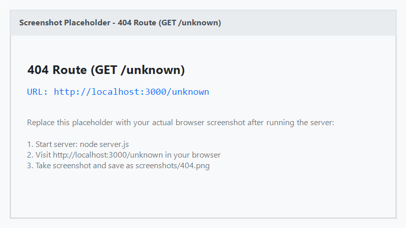

# Lab 1: Node.js and Express server

**Name:** VARUKURI ARJUN · **Registration No:** 252U1R1268 · **Section:** CSE-2E (211)  
**Live link:** [PASTE DEPLOYED URL HERE or write why it couldn't be deployed + add Postman screenshots]

## How to run

1. **Navigate to the lab folder:**
   ```bash
   cd lab-01
   ```

2. **Install project dependencies:**
   ```bash
   npm install
   ```

3. **Configure environment variables:**
   Copy the example environment file to create your local `.env`:
   ```bash
   # On Windows (cmd/PowerShell) or Linux/macOS
   cp .env.example .env
   ```
   *Note:* The required environment variable is `PORT` (e.g., `PORT=3000`). No sensitive secrets or credentials are required.

4. **Run the Express server:**
   ```bash
   npm start
   ```
   The server will start at `http://localhost:3000`.

5. **Run the plain HTTP server (optional):**
   ```bash
   npm run plain
   ```
   The plain HTTP server will start at `http://localhost:3000`.

## Endpoints

| Method | Path | Description | Expected Status |
| :--- | :--- | :--- | :--- |
| `GET` | `/` | Returns welcome text message | `200 OK` |
| `GET` | `/about` | Returns JSON object with student details (`name`, `section`) | `200 OK` |
| `GET` | `/time` | Returns current date and time as plain text (`new Date().toString()`) | `200 OK` |
| `ALL` | `/*` (any unknown path) | Catch-all handler for undefined routes (`"404 - Page not found"`) | `404 Not Found` |

## Screenshots








## package.json fields explained

- **`name`**: The unique name/identifier of the package or project (e.g., `lab-01`).
- **`version`**: The current release version of the application following Semantic Versioning (`major.minor.patch`).
- **`description`**: A concise human-readable summary of what the project does.
- **`main`**: The primary entry point file of the application that gets executed by default (`server.js`).
- **`scripts`**: Aliases/shortcuts for running command-line tasks (e.g., `npm start` runs `node server.js` and `npm run plain` runs `node plain-server.js`).
- **`dependencies`**: A list of third-party packages required for the project to run in production (e.g., `express`).
- **`author`**: The creator or maintainer of the project (`VARUKURI ARJUN`).
- **`license`**: The legal licensing terms determining how others may use or distribute the code (e.g., `ISC`).

## Viva notes

- **`package.json` vs `node_modules`:**
  - `package.json` is a lightweight project manifest file tracked in version control (Git). It documents project metadata, script commands, and the list of direct dependencies along with version rules.
  - `node_modules` is a local directory generated by `npm install` that houses the actual physical code of all installed dependencies and their recursive sub-dependencies. Because it is bulky and easily reproducible from `package.json` and `package-lock.json`, it is excluded from Git via `.gitignore`.

- **What `app.listen` does:**
  - `app.listen(PORT, callback)` binds the Express application to a specific network port on the host machine and starts listening for incoming client TCP connections. Once the port is open and ready to accept requests, the optional callback function is triggered (typically used to log a confirmation message).

- **What request and response represent:**
  - **`req` (Request object):** Represents the incoming HTTP request received from the client (e.g., browser or Postman). It contains information like request method, requested URL/path, headers, query parameters, URL parameters, and body payloads.
  - **`res` (Response object):** Represents the outgoing HTTP response that Express sends back to the client. It provides methods to set HTTP status codes (`res.status()`), response headers (`res.set()`), and send back data (`res.send()`, `res.json()`, `res.end()`).

## Notes

### Problems faced and how I solved them
- *Problem 1:* [Describe any issue faced, e.g., port conflict, package installation error, or route matching order]
- *Solution 1:* [Describe how you resolved it, e.g., killed process on port 3000, ensured 404 handler was placed after all routes]

